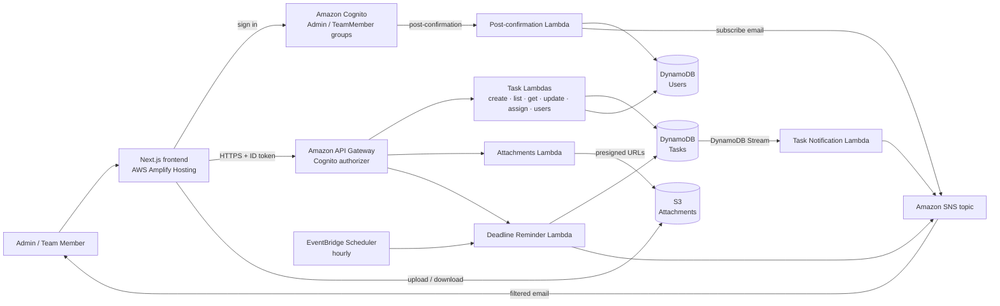

# AWS Serverless Task Management System

A learning project that demonstrates a task management workflow using AWS serverless services. Admins create, assign and track tasks; team members view their assigned tasks, update status and attach files. Everyone gets email notifications for assignments, status changes and approaching deadlines.

**Live app:** https://main.dou2fg6xeliu9.amplifyapp.com

**Planning document:** [docs/planning.md](docs/planning.md) · **Deployment evidence:** [docs/evidence/](#deployment-evidence)

## Features

| Feature | Admin | Team Member |
|---|---|---|
| Sign up, sign in, role-based views (Cognito) | ✅ | ✅ |
| Create tasks with title, description, assignee and deadline | ✅ | — |
| Assign and reassign tasks | ✅ | — |
| See all tasks | ✅ | Only their own |
| Change task status (`TODO` → `IN_PROGRESS` → `COMPLETED`) | ✅ | Own tasks |
| Edit title, description, deadline | ✅ | — |
| Upload and download attachments (S3) | ✅ | Own tasks |
| Send a deadline reminder on demand | ✅ | — |
| Email when assigned a task, or its deadline changes | — | ✅ |
| Email when a team member changes a task's status | ✅ | — |
| Automatic reminder 24 h before a deadline, overdue notice after | ✅ (overdue) | ✅ |

## Architecture



All Lambdas log to **Amazon CloudWatch**. Everything except the Amplify app is defined in [backend/template.yaml](backend/template.yaml) (AWS SAM) and deployed as one CloudFormation stack, `serverless-task-manager`, in `eu-west-1`.

### AWS services

| Service | Used for |
|---|---|
| **Amazon Cognito** | Sign-up and sign-in; `Admin` and `TeamMember` groups; ID tokens for the API. A post-confirmation trigger adds new users to `TeamMember`, saves them to the Users table and subscribes their email to notifications. |
| **Amazon API Gateway** | REST API (`dev` stage). A Cognito authorizer rejects requests without a valid token before they reach Lambda. |
| **AWS Lambda** | Business logic: one function per operation (Node.js 24), plus the post-confirmation trigger (Python 3.13). |
| **Amazon DynamoDB** | `Tasks` and `Users` tables (on-demand). The Tasks table's stream drives notifications. |
| **Amazon SNS** | One topic for all emails; each subscription's filter policy delivers only messages addressed to that user (or to `admins`). |
| **Amazon EventBridge Scheduler** | Runs the Deadline Reminder Lambda every hour. |
| **Amazon S3** | Private bucket for task attachments, accessed only through 5-minute presigned URLs. |
| **Amazon CloudWatch** | Logs for every Lambda (JSON format). |
| **AWS Amplify Hosting** | Builds and hosts the static Next.js frontend on every push to `main`. |
| **AWS Step Functions** | Optional in the brief and not used: every workflow here is a single step triggered by an API call, a stream or a schedule. |

## API

Base URL: `https://pw208myizd.execute-api.eu-west-1.amazonaws.com/dev`

Every request needs the Cognito **ID token** in the `Authorization` header. Each Lambda then checks the caller's group.

| Method | Path | Access | Lambda | Purpose |
|---|---|---|---|---|
| POST | `/tasks` | Admin | `CreateTaskFunction` | Create a task |
| GET | `/tasks` | Admin: all; Team Member: own | `ListTasksFunction` | List tasks |
| GET | `/tasks/{taskId}` | Admin, or assignee | `GetTaskFunction` | Get one task |
| PUT | `/tasks/{taskId}` | Admin: any field; assignee: `status` only | `UpdateTaskFunction` | Update a task |
| PUT | `/tasks/{taskId}/assign` | Admin | `AssignTaskFunction` | Assign or reassign a task |
| POST | `/tasks/{taskId}/notify` | Admin | `DeadlineReminderFunction` | Send a deadline reminder now |
| POST | `/tasks/{taskId}/attachments` | Admin, or assignee | `AttachmentsFunction` | Get a presigned upload (max 10 MB) |
| GET | `/tasks/{taskId}/attachments` | Admin, or assignee | `AttachmentsFunction` | List files with download links |
| GET | `/users` | Admin | `ListUsersFunction` | List users to choose an assignee |

The five routes in the lab brief are the first four rows plus `/notify`; the others support assignment, attachments and the assignee picker.

**Errors:** `400` invalid input · `401` missing or invalid token · `403` wrong role or not your task · `404` task not found.

## Notifications

API Lambdas only write to DynamoDB. The **Task Notification Lambda** reads each change from the Tasks table's stream, compares the old and new task, and publishes to SNS with a `recipient` attribute:

| Change | Recipient | Email |
|---|---|---|
| Task created with an assignee, or reassigned | New assignee | "New task assigned: …" |
| Status changed | `admins` | "Task In progress: …" (says who changed it) |
| Deadline changed | Assignee | "Deadline changed: …" |

The **Deadline Reminder Lambda** runs hourly. For open tasks it sends one reminder to the assignee when the deadline is within 24 hours, and one overdue notice (assignee and admins) once it passes. `reminderSentAt` and `overdueNotifiedAt` on the task prevent repeats, and changing the deadline clears them.

Each user's SNS email subscription has the filter policy `{"recipient": ["<userId>"]}`; admins also have `"admins"`. SNS sends a one-time **Confirm subscription** email that must be clicked before notifications arrive.

## Data model

**Tasks** (`serverless-task-manager-tasks`, key `taskId`)

| Attribute | Notes |
|---|---|
| `taskId` | UUID |
| `title`, `description` | Up to 200 / 2,000 characters |
| `status` | `TODO`, `IN_PROGRESS` or `COMPLETED` |
| `deadline` | Optional, UTC ISO 8601 |
| `assigneeId` | Cognito `sub` of the assignee |
| `createdBy`, `createdAt`, `updatedBy`, `updatedAt` | Audit fields |
| `reminderSentAt`, `overdueNotifiedAt` | Set by the reminder Lambda |

Indexes: `AssigneeIndex` (`assigneeId`) for a team member's tasks; `StatusDeadlineIndex` (`status`, `deadline`) for finding tasks due soon.

**Users** (`serverless-task-manager-users`, key `userId` = Cognito `sub`): `email`, `name`, `role`, `createdAt`.

**Attachments** are stored in S3 under `tasks/{taskId}/{uuid}/{fileName}`.

## Security

- **Authentication:** Cognito with verified email and a password policy; every API route has a Cognito authorizer.
- **Authorization:** each Lambda checks `cognito:groups`; team members can only see and change their own tasks, and only their status. Self sign-up always lands in `TeamMember`; only an AWS administrator can promote someone to `Admin`.
- **Least privilege:** each Lambda has its own IAM role with only the actions it needs (for example, `GetTaskFunction` can only `GetItem` on the Tasks table).
- **CORS:** Lambdas only return `Access-Control-Allow-Origin` for the Amplify site and `http://localhost:3000`.
- **Attachments:** Block Public Access on, encryption at rest, HTTPS-only bucket policy. Upload signatures fix the exact key and a 1 byte–10 MB size range, enforced by S3; links expire after 5 minutes.
- **Secrets:** none in the repository. Cognito IDs and the API URL are public by design; `.env.local` is git-ignored.

**Known limitations:** a leaked download link works until it expires (5 minutes); there is no per-user upload quota, file-type allowlist or malware scanning; a user's `role` in the Users table only changes to `Admin` when the promote script is used, not when the Cognito group is changed by hand.

## Repository layout

```
backend/
  template.yaml            AWS SAM template: every AWS resource
  samconfig.toml           Deploy settings (stack name, region)
  src/auth/                Cognito post-confirmation trigger (Python)
  src/tasks/               Task, notification, reminder and attachment Lambdas (Node.js)
  scripts/promote-admin.sh Promote a user to Admin
frontend/                  Next.js static site hosted on Amplify
docs/
  planning.md              Phase 1 requirements and planning
  evidence/                Deployment screenshots
amplify.yml                Amplify build settings
```

## Deploying

**Prerequisites:** AWS CLI (configured for `eu-west-1`), AWS SAM CLI, Node.js 22+, Python 3.12+.

### Backend

```bash
cd backend
sam build
sam deploy
```

`samconfig.toml` fixes the stack name, so every deploy updates the same stack and the Cognito IDs and API URL stay the same. Review the change set before confirming: `UserPool`, `TasksTable` and `TaskApi` should never show **Replacement**.

### Frontend

The Amplify app is connected to this repository's `main` branch and rebuilds on every push using [amplify.yml](amplify.yml). Its environment variables:

| Variable | Value |
|---|---|
| `NEXT_PUBLIC_AWS_REGION` | `eu-west-1` |
| `NEXT_PUBLIC_USER_POOL_ID` | Stack output `UserPoolId` |
| `NEXT_PUBLIC_USER_POOL_CLIENT_ID` | Stack output `UserPoolClientId` |
| `NEXT_PUBLIC_API_URL` | Stack output `ApiUrl` (without the trailing slash) |
| `AMPLIFY_MONOREPO_APP_ROOT` | `frontend` |

To run locally, copy `frontend/.env.example` to `frontend/.env.local`, fill in the values, then:

```bash
cd frontend
npm install
npm run dev
```

### Making someone an Admin

New users sign up on the site and become Team Members. To promote one (adds them to the `Admin` group, updates the Users table and enables admin emails):

```bash
backend/scripts/promote-admin.sh user@example.com
```

They need to sign out and back in.

### Testing reminders without waiting an hour

```bash
aws lambda invoke --function-name $(aws cloudformation describe-stack-resource --stack-name serverless-task-manager --logical-resource-id DeadlineReminderFunction --query StackResourceDetail.PhysicalResourceId --output text) /dev/stdout
```

### Tearing down

Empty the attachments bucket first (CloudFormation can't delete a bucket with files in it), then delete the stack and the Amplify app:

```bash
aws s3 rm s3://$(aws cloudformation describe-stacks --stack-name serverless-task-manager --query "Stacks[0].Outputs[?OutputKey=='AttachmentsBucketName'].OutputValue" --output text) --recursive
sam delete --stack-name serverless-task-manager
```

## Cost

Everything is pay-per-use with no always-on servers. At lab traffic the stack costs close to nothing: Lambda, API Gateway, DynamoDB on-demand, SNS email (first 1,000/month free), EventBridge Scheduler (~720 runs/month) and S3 are all within or near the free tier. Amplify builds cost about $0.01 per build minute.

## Project phases

Following the phases in the lab brief:

- [x] **Phase 1 — Requirement Analysis and Planning:** [docs/planning.md](docs/planning.md)
- [x] **Phase 2 — Setting Up the Environment:** Cognito user pool and groups, DynamoDB tables, API Gateway with Cognito authorizer
- [x] **Phase 3 — Lambda Functions Development:** Task Creation, Task Assignment, Task Update, Task Status Notification, Deadline Reminder, and API integration
- [x] **Phase 4 — API Gateway Configuration:** all brief endpoints, plus assignment, attachments and users
- [x] **Phase 5 — Notification System:** SNS email for assignments, updates, approaching and passed deadlines
- [x] S3 attachments
- [ ] AWS Step Functions (optional, not used)

## Deployment evidence

| # | Screenshot | Shows |
|---|---|---|
| 1 | [Admin dashboard](docs/evidence/01-admin-dashboard.png) | Admin view: New task form, all tasks, assignee dropdowns, attachments |
| 2 | [Team member dashboard](docs/evidence/02-team-member-dashboard.png) | Team member sees only their own task, with status and attachments |
| 3 | [Cognito users](docs/evidence/03-cognito-users.png) | Two confirmed users in the user pool |
| 4 | [CloudFormation stack](docs/evidence/04-cloudformation-stack-resources.png) | `serverless-task-manager` stack, `UPDATE_COMPLETE`, 45 resources |
| 5 | [API Gateway routes](docs/evidence/05-api-gateway-routes.png) | All routes on the REST API, with Lambda proxy integration |
| 6 | [Lambda functions](docs/evidence/06-lambda-functions.png) | The stack's ten Lambda functions |
| 7 | [DynamoDB tables](docs/evidence/07-dynamodb-tables.png) | Tasks table (2 indexes) and Users table, on-demand |
| 8 | [SNS subscriptions](docs/evidence/08-sns-subscriptions.png) | Notifications topic with two confirmed email subscriptions |
| 9 | [S3 bucket](docs/evidence/09-s3-attachments-bucket.png) | Attachments bucket in `eu-west-1` |
| 10 | [Amplify deployment](docs/evidence/10-amplify-deployment.png) | `main` branch deployed from GitHub to the live URL |
