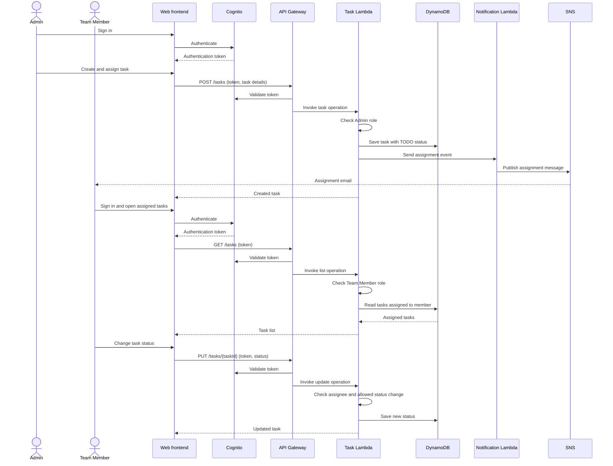
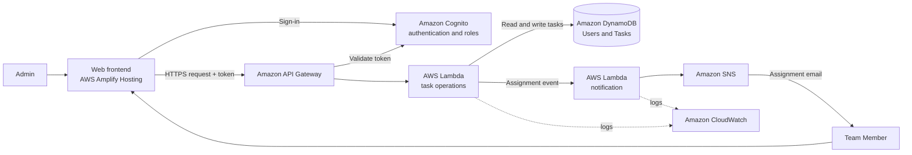

# Phase 1 — Requirements and Planning

This plan scopes the lab as a learning project. The goal is to understand how a small serverless application uses AWS services together, not to build a production-ready task platform.

## 1. Users and requirements

### Admin

- Sign in.
- Create a task with a title, description, assignee, and optional deadline.
- View the task list and task details.
- Change task details or assignment.

### Team member

- Sign in.
- View tasks assigned to them.
- Change a task's status to `TODO`, `IN_PROGRESS`, or `COMPLETED`.

### System

- Notify the assignee by email when a task is assigned.
- Record enough information to show task ownership, status, and deadline.

## 2. Basic workflow

1. An Admin signs in and creates a task, selecting a team member and optionally setting a deadline.
2. The task is stored with status `TODO`.
3. The assigned team member receives an email notification.
4. The team member signs in, views their assigned task, and updates its status as work progresses.
5. The Admin can view the updated status and change task details or assignment.

Deadline reminders are an extension to this first workflow. The task will store a deadline, but automatic scheduled reminders are not part of the initial implementation.

### Workflow diagram

## 3. AWS services and learning purpose

| AWS service | Use in this project | Learning focus |
|---|---|---|
| Amazon Cognito | Sign-in and Admin/Team Member roles | Authentication and role-aware access |
| Amazon API Gateway | Expose task endpoints | Routing HTTP requests to backend code |
| AWS Lambda | Create, list, read, and update tasks | Event-driven backend logic |
| Amazon DynamoDB | Store users and tasks | Basic serverless data storage |
| Amazon SNS | Send an assignment email | Publish a simple event notification |
| Amazon CloudWatch | View Lambda logs and errors | Basic debugging and monitoring |
| Amazon S3 | Optional extension for task attachments | Object storage |
| AWS Step Functions | Not needed for the initial workflow | Optional orchestration for a more complex workflow |

The frontend is a small web client. AWS Amplify Hosting can publish it from this repository; it is separate from the task API and its backend services.

### Architecture diagram

The diagram shows the intended learning architecture. The assignment notification can be invoked directly by the task operation so the first version does not need a DynamoDB stream or a workflow orchestrator.

## 4. Initial data model

The initial model uses two entities. `status` and `deadline` are fields on a task, not separate entities.

### User

- `userId`: Cognito user identifier
- `name`: display name
- `email`: notification address
- `role`: `Admin` or `TeamMember`

### Task

- `taskId`: unique identifier
- `title`: task title
- `description`: short task description
- `assigneeId`: user identifier of the assigned team member
- `status`: `TODO`, `IN_PROGRESS`, or `COMPLETED`
- `deadline`: optional date/time
- `createdBy`: user identifier of the Admin who created the task

This is a conceptual Phase 1 model. The exact DynamoDB key and table design can be decided during environment setup.

## 5. Basic security requirements

- Users must sign in through Cognito before using task features.
- The application distinguishes Admins from Team Members.
- Only Admins can create tasks, assign tasks, or edit task details.
- Team Members can view and update the status of tasks assigned to them.
- The API must check the caller's identity and role before performing an operation.
- Credentials and secrets must not be committed to the repository.

These are the access rules the learning project will demonstrate. Detailed production hardening is outside the current scope.

## 6. Scope boundaries

### Initial implementation

- Sign-in with Admin and Team Member roles.
- Create and assign a task.
- List tasks according to role and get task details.
- Update task status; allow Admins to edit task details.
- Send a basic assignment email.
- Store an optional deadline and inspect Lambda logs in CloudWatch.

### Extensions, after the core flow works

- Automatic deadline reminders.
- Task attachments in S3.
- Multi-step workflows with Step Functions.
- Advanced filtering, audit history, retry handling, and production monitoring.

## 7. Later phases

These follow the phase definitions in the lab brief.

- **Phase 2 — Setting Up the Environment:** set up Amazon Cognito, DynamoDB and API Gateway. Configure Cognito for Admin/Team Member authentication, create DynamoDB tables for task data and user information, and set up API Gateway for the task management REST API.
- **Phase 3 — Lambda Functions Development:** build the Task Creation (Admin), Task Assignment (Admin), Task Update (status and deadline changes), Task Status Notification (SNS on create/update) and Deadline Reminder Lambdas, and integrate them with API Gateway.
- **Phase 4 — API Gateway Configuration:** expose `POST /tasks` (Admin), `GET /tasks` (Admin), `GET /tasks/{taskId}` (Admin and Team Members), `PUT /tasks/{taskId}` (Admin and Team Members) and `POST /tasks/{taskId}/notify` (deadline notifications).
- **Phase 5 — Notification System:** use SNS to notify team members when tasks are assigned, updated or approaching deadlines, with a Lambda notification function and email notifications through SNS topics.
