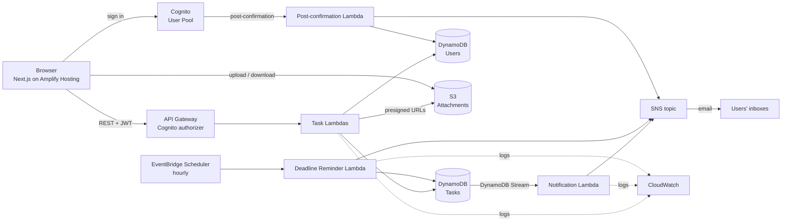
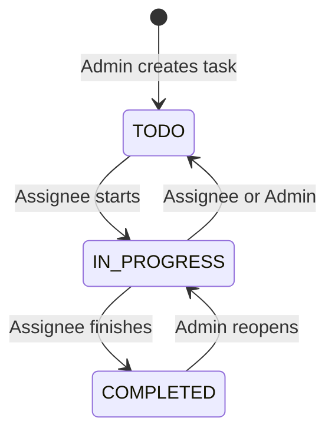
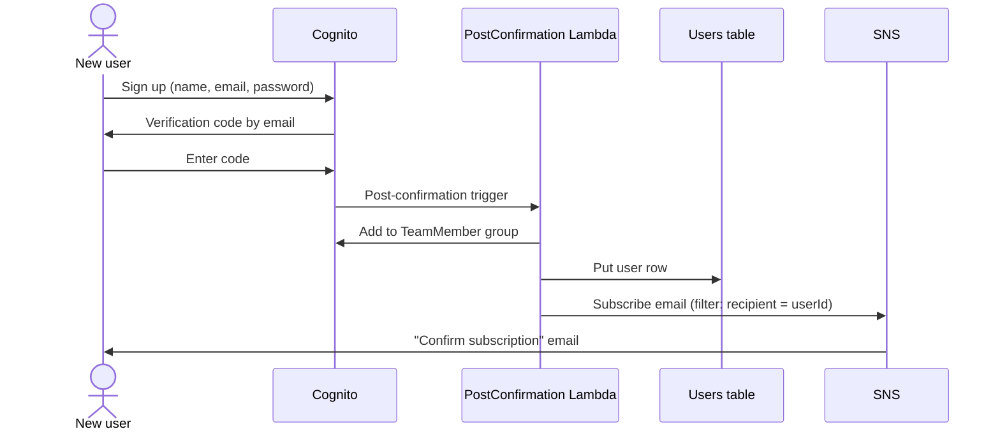
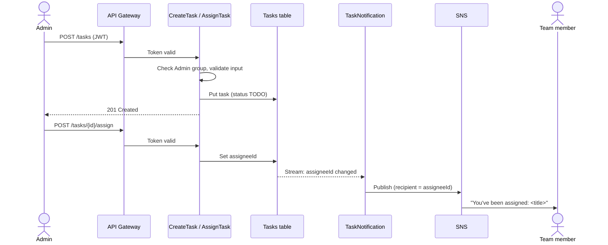
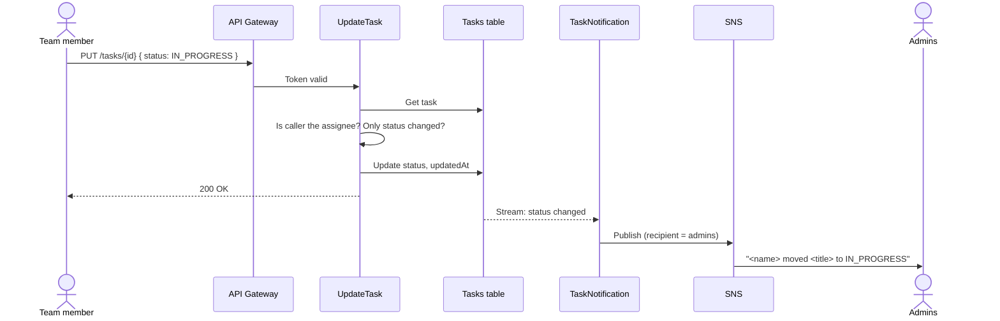
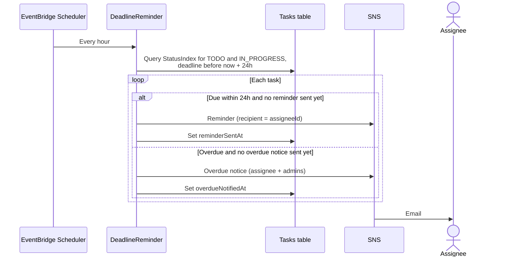

# Phase 1 — Requirements and Planning

This document covers Phase 1 of the project: requirements, workflows, AWS services, the data model, and security. Later phases build against the decisions recorded here.

## 1. Users and roles

| Role | How you get it | What you can do |
|---|---|---|
| **Admin** | Promoted manually by an existing admin (Cognito `Admin` group) | Create, assign, update and delete any task; see all tasks and all users; trigger deadline reminders |
| **Team Member** | Automatically on sign-up (Cognito `TeamMember` group) | See tasks assigned to them; update the status of those tasks; add attachments to them |

Nobody can make themselves an admin: self sign-up always lands in `TeamMember`.

## 2. Requirements

### 2.1 Functional

| ID | Requirement | Role |
|---|---|---|
| FR-1 | Users sign up with name, email and password, and verify their email | All |
| FR-2 | Users sign in and out; the app shows features for their role | All |
| FR-3 | Admin creates a task with title, description, priority and deadline | Admin |
| FR-4 | Admin assigns or reassigns a task to a team member | Admin |
| FR-5 | Admin lists all tasks and filters by status or assignee | Admin |
| FR-6 | Team member lists only the tasks assigned to them | Team Member |
| FR-7 | Both roles view a single task's details (team members: own tasks only) | All |
| FR-8 | Team member updates the status of their task (`TODO` → `IN_PROGRESS` → `COMPLETED`) | Team Member |
| FR-9 | Admin updates any field of any task, including deadline and assignee | Admin |
| FR-10 | Assignee receives an email when a task is assigned to them | System |
| FR-11 | Admins receive an email when a team member changes a task's status | System |
| FR-12 | Assignee receives an email when their task's deadline changes | System |
| FR-13 | Assignee receives a reminder 24 hours before a deadline, and an overdue notice after it passes | System |
| FR-14 | Admin manually triggers a deadline reminder for a task | Admin |
| FR-15 | Users upload and download file attachments on tasks they can access | All |
| FR-16 | Admin lists users so they can choose an assignee | Admin |

### 2.2 Non-functional

| ID | Requirement |
|---|---|
| NFR-1 | Fully serverless: no servers or containers to manage, and close to $0 cost when idle |
| NFR-2 | All infrastructure defined as code (AWS SAM) and redeployable with one command |
| NFR-3 | All traffic over HTTPS; every API call authenticated with a Cognito token |
| NFR-4 | Least-privilege IAM: each Lambda can only touch the resources it needs |
| NFR-5 | Logs for every Lambda and the API in CloudWatch, kept for 14 days |
| NFR-6 | API responses under 1 second for normal use |
| NFR-7 | Stable URLs: the frontend, API and Cognito IDs don't change between deployments |

## 3. Architecture

### 3.1 AWS services

| Service | Used for |
|---|---|
| **Amazon Cognito** | User pool, sign-up/sign-in, `Admin` and `TeamMember` groups, JWTs for the API |
| **Amazon API Gateway** (REST) | Public REST API; a Cognito authorizer rejects requests without a valid token |
| **AWS Lambda** (Python 3.13) | All business logic (see section 6) |
| **Amazon DynamoDB** | `Tasks` and `Users` tables, on-demand billing; Streams on `Tasks` drive notifications |
| **Amazon SNS** | One topic; each user subscribes by email with a filter policy so they only get their own messages |
| **Amazon S3** | Private bucket for attachments, accessed only through short-lived presigned URLs |
| **Amazon EventBridge Scheduler** | Runs the deadline-reminder Lambda every hour |
| **Amazon CloudWatch** | Lambda and API logs, error metrics |
| **AWS Amplify Hosting** | Hosts the static Next.js frontend and redeploys on every push to `main` |
| **AWS Step Functions** (optional) | **Not used.** The workflows are single-step and event-driven, so streams and the scheduler cover them more simply and cheaply |

## 4. Data model

The lab's four entities (**Task**, **User**, **Status**, **Deadline**) map to two DynamoDB tables. Status and Deadline are attributes of a task rather than separate tables, because they always belong to exactly one task.

### 4.1 `Tasks` table

| Attribute | Type | Notes |
|---|---|---|
| `taskId` | String (UUID) | **Partition key** |
| `title` | String | Required, 1–200 characters |
| `description` | String | Optional, up to 2,000 characters |
| `status` | String | `TODO`, `IN_PROGRESS` or `COMPLETED` |
| `priority` | String | `LOW`, `MEDIUM` or `HIGH` |
| `deadline` | String (ISO 8601, UTC) | e.g. `2026-11-20T17:00:00Z` |
| `assigneeId` | String | Cognito `sub` of the assignee; absent if unassigned |
| `createdBy` | String | Cognito `sub` of the admin who created it |
| `createdAt` / `updatedAt` | String (ISO 8601) | Set by the API |
| `attachments` | List of maps | `{ key, fileName, size, uploadedBy, uploadedAt }` |
| `reminderSentAt` | String (ISO 8601) | Prevents sending the 24-hour reminder twice |
| `overdueNotifiedAt` | String (ISO 8601) | Prevents sending the overdue notice twice |

**Global secondary indexes**

| Index | Partition key | Sort key | Used for |
|---|---|---|---|
| `AssigneeIndex` | `assigneeId` | `deadline` | A team member's tasks, soonest deadline first (FR-6) |
| `StatusIndex` | `status` | `deadline` | Filtering by status (FR-5), and finding open tasks with deadlines approaching (FR-13) |

**Status lifecycle**

"Overdue" is not a stored status. The app shows it when `deadline` has passed and `status` isn't `COMPLETED`.

### 4.2 `Users` table

| Attribute | Type | Notes |
|---|---|---|
| `userId` | String | **Partition key**; the Cognito `sub` |
| `email` | String | |
| `name` | String | |
| `role` | String | `Admin` or `TeamMember`, mirrored from Cognito groups |
| `createdAt` | String (ISO 8601) | |

The post-confirmation Lambda writes a row when a user verifies their email. Cognito stays the source of truth for login; this table lets the API list users and look up names and emails without calling Cognito on every request.

## 5. API

All routes require a valid Cognito ID token in the `Authorization` header. Each Lambda then checks the `cognito:groups` claim against the access rules below.

| Method and path | Admin | Team Member | Lambda | Lab endpoint? |
|---|---|---|---|---|
| `POST /tasks` | ✅ | ❌ | `CreateTask` | Yes |
| `GET /tasks` | All tasks (filter by `status`, `assigneeId`) | Only their own tasks | `ListTasks` | Yes ¹ |
| `GET /tasks/{taskId}` | ✅ | Own tasks only | `GetTask` | Yes |
| `PUT /tasks/{taskId}` | Any field | `status` only, own tasks only | `UpdateTask` | Yes |
| `POST /tasks/{taskId}/assign` | ✅ | ❌ | `AssignTask` | Added ² |
| `POST /tasks/{taskId}/notify` | ✅ | ❌ | `DeadlineReminder` | Yes |
| `POST /tasks/{taskId}/attachments` | ✅ | Own tasks only | `Attachments` | Added ³ |
| `GET /tasks/{taskId}/attachments/{key}` | ✅ | Own tasks only | `Attachments` | Added ³ |
| `GET /users` | ✅ | ❌ | `ListUsers` | Added ⁴ |

1. The lab lists `GET /tasks` as admin-only. Team members also need a way to see their tasks (FR-6), so the same endpoint returns only their own tasks when a team member calls it, instead of adding a separate route.
2. Gives the lab's **Task Assignment** function its own endpoint, separate from general updates.
3. Returns a presigned S3 URL for uploading or downloading a file (FR-15).
4. Admins need the user list to pick an assignee (FR-16).

**Errors:** `400` invalid input, `401` missing or invalid token (from API Gateway), `403` wrong role or not your task, `404` task not found.

## 6. Lambda functions

| Function | Trigger | Lab requirement |
|---|---|---|
| `CreateTask` | `POST /tasks` | Task Creation |
| `AssignTask` | `POST /tasks/{taskId}/assign` | Task Assignment |
| `UpdateTask` | `PUT /tasks/{taskId}` | Task Update |
| `GetTask`, `ListTasks`, `ListUsers` | API Gateway | API Integration |
| `Attachments` | API Gateway | S3 file attachments |
| `TaskNotification` | DynamoDB Stream on `Tasks` | Task Status Notification |
| `DeadlineReminder` | EventBridge Scheduler (hourly) and `POST /tasks/{taskId}/notify` | Deadline Reminder |
| `PostConfirmation` *(deployed)* | Cognito post-confirmation | Adds user to `TeamMember`; writes `Users` row; subscribes email to SNS |

**Why notifications use a stream:** the API Lambdas only write to DynamoDB. `TaskNotification` reads the before and after versions of each changed task from the stream and decides who to email. That keeps the API fast, and any change to a task triggers a notification however it was made.

## 7. Workflows

### 7.1 Sign-up

The user must click SNS's confirmation link once before they receive notifications. This is an SNS requirement for email subscriptions.

### 7.2 Create and assign a task

### 7.3 Team member updates status

### 7.4 Deadline reminders

`POST /tasks/{taskId}/notify` runs the same reminder for one task immediately, ignoring `reminderSentAt`. If an admin changes the deadline, `UpdateTask` clears both flags so the reminders can fire again.

### 7.5 Attachments

1. The client calls `POST /tasks/{taskId}/attachments` with the file name and size.
2. The Lambda checks the caller can access the task, then returns a presigned upload URL valid for 5 minutes, limited to 10 MB.
3. The browser uploads the file straight to S3. The file never passes through Lambda.
4. The Lambda records the attachment on the task. Downloads work the same way, with a presigned download URL.

## 8. Notification routing

There's one SNS topic. Each user's email subscription has a filter policy, so they only get messages addressed to them:

| Subscriber | Filter policy |
|---|---|
| Any user | `{ "recipient": ["<their userId>"] }` |
| Admins (added when promoted) | `{ "recipient": ["<their userId>", "admins"] }` |

| Event | Recipient attribute |
|---|---|
| Task assigned or reassigned | New assignee's `userId` |
| Deadline changed | Assignee's `userId` |
| Status changed by a team member | `admins` |
| Deadline in 24 hours | Assignee's `userId` |
| Deadline passed | Assignee's `userId`, then `admins` |

## 9. Security

| Area | Control |
|---|---|
| **Authentication** | Cognito user pool: verified email required, password of at least 8 characters with upper case, lower case and numbers |
| **Authorization at the edge** | API Gateway Cognito authorizer on every route; requests without a valid token never reach Lambda |
| **Authorization in code** | Each Lambda checks `cognito:groups`, and for team members checks they are the task's assignee and are only changing allowed fields |
| **Privilege escalation** | Self sign-up only grants `TeamMember`; `Admin` can only be granted by an AWS administrator |
| **Least privilege IAM** | Each function gets its own role with only the actions and tables it needs (for example, `GetTask` can only read `Tasks`) |
| **Data at rest** | DynamoDB and S3 encrypted by default (AWS-managed keys) |
| **Data in transit** | HTTPS only: Amplify, API Gateway, and an S3 bucket policy that denies non-TLS requests |
| **S3 attachments** | Block Public Access on; files only reachable through presigned URLs that expire after 5 minutes; 10 MB limit |
| **CORS** | API and bucket only accept browser requests from the Amplify domain and `localhost` |
| **Input validation** | Lambdas validate types, lengths, enum values and dates; unknown fields are rejected |
| **Abuse protection** | API Gateway stage throttling (for example 20 requests/second, burst 40) |
| **Secrets** | No secrets in the repo; Cognito IDs are public by design; `.env` files are git-ignored |
| **Monitoring** | CloudWatch logs (14-day retention) and an alarm on Lambda errors |

## 10. Assumptions and out of scope

- Email is the only notification channel. SMS is possible through SNS, but it costs money and needs an origination number in many countries.
- One assignee per task.
- Times are stored in UTC; the browser shows them in local time.
- Out of scope: comments, task history and audit log, teams or projects, and deleting users.

## 11. Delivery plan

| Phase | Deliverables | Status |
|---|---|---|
| 1. Requirements and planning | This document | ✅ |
| 2. Environment setup | Cognito ✅; DynamoDB `Tasks` and `Users` tables with indexes and stream; API Gateway with Cognito authorizer | 🟡 |
| 3. Lambda development | The functions in section 6, with unit tests | ⬜ |
| 4. API Gateway configuration | The routes in section 5, CORS, throttling | ⬜ |
| 5. Notification system | SNS topic, filter-policy subscriptions, `TaskNotification` stream consumer, hourly `DeadlineReminder` | ⬜ |
| Frontend (not a lab phase) | Login ✅; admin and team-member dashboards | 🟡 |
