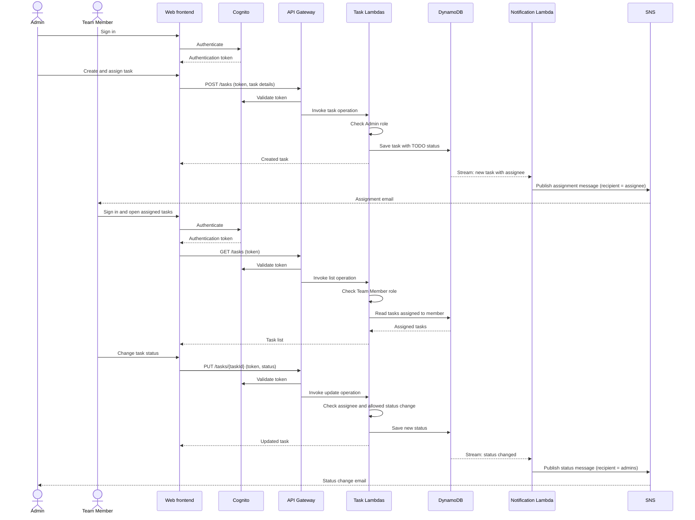
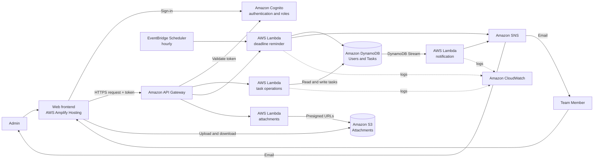

# Phase 1 — Requirements and Planning

This plan scopes the lab as a learning project. The goal is to understand how a small serverless application uses AWS services together, not to build a production-ready task platform.

> **Updated after implementation.** The first version of this plan kept deadline reminders and S3 attachments as extensions and had the task Lambda call the notifier directly. While building against the lab brief's phase definitions, reminders, attachments and update notifications became part of the core, and notifications moved to a DynamoDB stream. The sections below describe what was built; the README has the full API and deployment details.

## 1. Users and requirements

### Admin

- Sign in.
- Create a task with a title, description, assignee, and optional deadline.
- View the task list and task details.
- Change task details or assignment.
- Send a deadline reminder for a task.
- Upload and download task attachments.

### Team member

- Sign in.
- View tasks assigned to them.
- Change a task's status to `TODO`, `IN_PROGRESS`, or `COMPLETED`.
- Upload and download attachments on their tasks.

### System

- Notify the assignee by email when a task is assigned.
- Notify Admins by email when a task's status changes.
- Notify the assignee when their task's deadline changes.
- Remind the assignee 24 hours before a deadline, and notify the assignee and Admins once it has passed.
- Record enough information to show task ownership, status, and deadline.

## 2. Basic workflow

1. An Admin signs in and creates a task, selecting a team member and optionally setting a deadline.
2. The task is stored with status `TODO`.
3. The assigned team member receives an email notification.
4. The team member signs in, views their assigned task, and updates its status as work progresses.
5. The Admin can view the updated status and change task details or assignment.
6. Every hour, the system reminds assignees about deadlines in the next 24 hours and flags overdue tasks. An Admin can also send a reminder for one task on demand.

### Workflow diagram

## 3. AWS services and learning purpose

| AWS service                  | Use in this project                                                                                    | Learning focus                                               |
| ---------------------------- | ------------------------------------------------------------------------------------------------------ | ------------------------------------------------------------ |
| Amazon Cognito               | Sign-in and Admin/Team Member roles                                                                    | Authentication and role-aware access                         |
| Amazon API Gateway           | Expose task endpoints                                                                                  | Routing HTTP requests to backend code                        |
| AWS Lambda                   | Create, list, read, update and assign tasks; send notifications and reminders; sign attachment uploads | Event-driven backend logic                                   |
| Amazon DynamoDB              | Store users and tasks; stream task changes                                                             | Basic serverless data storage and change streams             |
| Amazon SNS                   | Send assignment, status, deadline and reminder emails                                                  | Publish event notifications with per-user filter policies    |
| Amazon EventBridge Scheduler | Run the deadline reminder every hour                                                                   | Scheduled serverless jobs                                    |
| Amazon CloudWatch            | View Lambda logs and errors                                                                            | Basic debugging and monitoring                               |
| Amazon S3                    | Store task attachments                                                                                 | Object storage with presigned URLs                           |
| AWS Step Functions           | Not used                                                                                               | Optional orchestration; every workflow here is a single step |

The frontend is a small web client. AWS Amplify Hosting can publish it from this repository; it is separate from the task API and its backend services.

### Architecture diagram

The task Lambdas only write to DynamoDB. The notification Lambda reads each change from the Tasks table's stream and decides who to email, so any change to a task (create, assign or update) sends the right notification without the task Lambdas knowing about SNS.

## 4. Data model

The model uses two entities. `status` and `deadline` are fields on a task, not separate entities.

### User

- `userId`: Cognito user identifier
- `name`: display name
- `email`: notification address
- `role`: `Admin` or `TeamMember`

### Task

- `taskId`: unique identifier
- `title`: task title
- `description`: short task description
- `assigneeId`: user identifier of the assigned team member
- `status`: `TODO`, `IN_PROGRESS`, or `COMPLETED`
- `deadline`: optional date/time
- `createdBy`: user identifier of the Admin who created the task
- `updatedBy`, `createdAt`, `updatedAt`: who changed the task last, and when
- `reminderSentAt`, `overdueNotifiedAt`: set by the reminder so each notice is sent once

### DynamoDB design (decided during environment setup)

| Table | Key        | Indexes                                                                                                                             |
| ----- | ---------- | ----------------------------------------------------------------------------------------------------------------------------------- |
| Tasks | `taskId` | `AssigneeIndex` (`assigneeId`) for a team member's tasks; `StatusDeadlineIndex` (`status`, `deadline`) for tasks due soon |
| Users | `userId` | —                                                                                                                                  |

The Tasks table streams old and new versions of each changed task to the notification Lambda. Attachments are not stored in DynamoDB; they live in S3 under `tasks/{taskId}/`.

## 5. Basic security requirements

- Users must sign in through Cognito before using task features.
- The application distinguishes Admins from Team Members.
- Only Admins can create tasks, assign tasks, or edit task details.
- Team Members can view and update the status of tasks assigned to them.
- The API must check the caller's identity and role before performing an operation.
- Credentials and secrets must not be committed to the repository.
- Attachments must not be publicly accessible; uploads and downloads use short-lived presigned URLs.
- Each user must only receive notifications meant for them.

These are the access rules the learning project will demonstrate. Detailed production hardening is outside the current scope.

## 6. Scope boundaries

### Implemented

- Sign-in with Admin and Team Member roles.
- Create and assign a task.
- List tasks according to role and get task details.
- Update task status; allow Admins to edit task details.
- Assignment, status-change and deadline-change emails.
- Automatic deadline reminders and overdue notices, plus on-demand reminders.
- Task attachments in S3.
- Store an optional deadline and inspect Lambda logs in CloudWatch.
